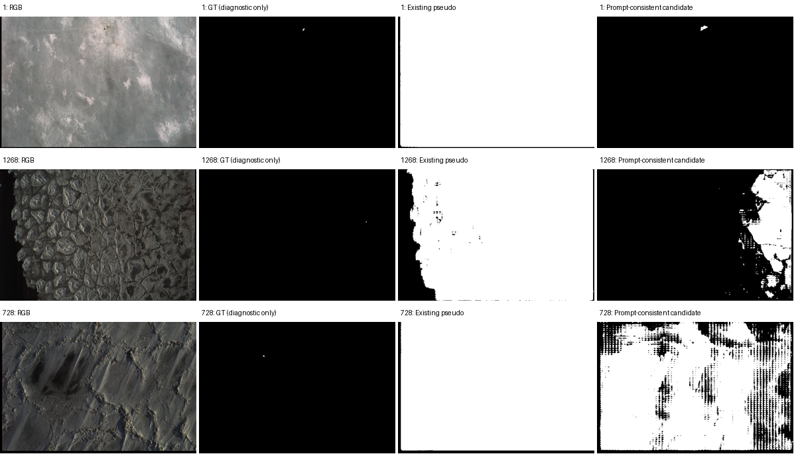

# FCT-SAM-WSCOD：Seal 实验记录

主表采用作者公开完整 COD 权重在 Seal test 上的跨域泛化结果。四项指标统一采用 [Ours/evaluate.py](../Ours/evaluate.py) 中的四个固定原函数；IoU、F1、Pd、Fa 使用根目录 `metrics.py` 与 `evaluate_small_targets.py`。

## 主表协议

- 权重：`FCT-SAM-WSCOD-main/pretrain/Pvtv2_TE_new_dataset_batch4_epoch60.pth`，完整编码器与 `decoder_baseline`，检查点内部记录 epoch 33。
- 输入：Seal test RGB，384×384。沿用作者归一化、末级输出、恢复原尺寸、sigmoid、逐图 min-max 和灰度 PNG 保存流程。
- 测试预测：`results/FCT-SAM-WSCOD/Seal/test_maps/`，1,983 张，与测试 GT 文件名完整对应，无缺失或多余。
- 不使用 Seal train/val、box、GT 抽点或伪标签进行训练、适配及模型选择，不根据 Seal 分数更换检查点或后处理。CAMO 源域复核仅用于确认实现。
- 现有发布材料未明确指定该文件为论文最终模型。参数严格匹配及源域结果接近论文支持其可用性，文件名不能证明其最终模型身份。
- Seal 点监督、框监督及 SAM 伪标签适配均已停止，历史产物保留，不进入跨域主表；没有 FCT 训练排队或自动跟进任务。

2026-11-03 核对当前服务器 `evaluate.py`、`Ours/evaluate.py` 和已有评估源码快照，四个指标函数原文一致。八项数值与原始完整精度 JSON 一致，预测数量及来源正确，直接复用，不重复训练、推理或评估。核对记录见 [cross_domain_protocol_check.json](FCT-SAM-WSCOD_诊断_20261103/cross_domain_protocol_check.json)。

## 结果汇总

跨域主表仅使用 Seal test 的 1,983 张预测。下表同时保留历史点监督适配结果；该历史实验使用 train 1,500、val 500 的划分，不属于跨域协议。E 为原函数对连续灰度预测的计算结果，再按图像取均值。两组已有预测各有 1,983 张，于 2026-11-03 完成固定原函数重评估。

| 实验 | S↑ | Fw↑ | E↑ | MAE↓ | IoU↑ | F1↑ | Pd↑ | Fa↓ |
|---|---:|---:|---:|---:|---:|---:|---:|---:|
| 公开完整权重→Seal 跨域测试（主表） | 0.46631 | 0.00363 | 0.27307 | 0.04036 | 0.00067187 | 0.00134283 | 0.00257348 | 0.03467404 |
| Seal 稀疏点监督适配（历史实验） | 0.34589 | 0.00048 | 0.25038 | 0.38366 | 0.00028098 | 0.00056181 | 0.02261953 | 0.32932903 |

跨域测试直接加载 COD 完整检查点；适配实验从同一完整权重初始化，训练 60 epoch，按 val MAE 使用第 45 epoch。主表只保留跨域测试一组结果，适配及诊断结果保留在本文。Fa 为 0～1 原始比例。

IoU、F1、Pd、Fa 由根目录 `metrics.py` 的 `AS1000Metrics` 和 `evaluate_small_targets.py` 计算。每行八项指标使用同一检查点与同一批原尺寸 PNG，没有额外归一化、后处理或阈值选择。完整数值与来源见 [eight_metric_results.json](FCT-SAM-WSCOD_诊断_20261103/eight_metric_results.json)，小目标协议见 [小目标评价指标_定义与代码对照.md](小目标评价指标_定义与代码对照.md)。

## 公开模型与适配监督诊断

### 公开模型：权重、推理与源域验证

固定使用 `Pvtv2_TE_new_dataset_batch4_epoch60.pth`，不比较或改选其他检查点。作者仓库当前 `TestCamoFormer.py` 默认导入 `decoder_CrossVit`，该分支与本检查点参数不兼容；本检查点与仓库 `decoder_baseline` 严格匹配。输入遵循作者 `dataset.py` 的 RGB/ImageNet 归一化、384×384 双线性缩放及 `align_corners=True`；输出遵循 `test.py` 的末级输出、原尺寸双线性插值、sigmoid、逐图 min-max 和 8 位灰度 PNG 保存流程。解码器本身包含 sigmoid，测试入口再次调用 sigmoid 的行为与作者代码一致。

用作者原始矩阵乘法重算预先固定的 3 张 Seal 图，保存 PNG 与既有 PNG 完全一致；等价通道乘法与原乘法的归一化输出最大绝对差为 0.000153，未用于修改现有测试预测。

在服务器已有 CAMO test 的 250 张图像上，用同一检查点及作者原前向测试，并使用作者 `utils/metrics.py` 计算源域诊断指标：

| 来源 | S | adaptive F | mean E | MAE |
|---|---:|---:|---:|---:|
| 论文 CAMO 主方法结果 | 0.849 | 0.828 | 0.911 | 0.055 |
| 固定检查点 CAMO 复核 | 0.84870636 | 0.82776561 | 0.90931096 | 0.05558098 |

源域结果与论文接近，支持权重和推理链路正常、Seal 上存在明显跨域失效的判断。CAMO 的作者口径指标仅用于源域复核，不替代 Seal 主表的四个固定原函数。详细数据及抽样 PNG 比对见 [source_audit.json](FCT-SAM-WSCOD_诊断_20261103/source_audit.json)。作者公开入口见 [TestCamoFormer.py](https://github.com/farewellIamLoser/FCT-SAM-WSCOD/blob/main/model/TestCamoFormer.py)。

### Seal 适配：SAM 逐阶段诊断

按训练文件排序后，预先以等间隔索引固定 16 张图像，每张仍使用既有的 1 前景点、5 背景点与 10 个增强视图。候选选择不读取稠密 GT；GT 只用于事后诊断统计。

| 审查项 | 证据与结论 |
|---|---|
| 论文响应定义 | [论文第 125 页](../FCT-SAM-WSCOD-main/FAIA-413-FAIA250797.pdf#page=4) 式 (4)～(6) 定义平均二值响应及 μ/τ，τ=4。对固定视图集合，计数与均值中的视图数量因子抵消，原 μ/4 写法与该阈值等价。不能将其误判为应乘以 4。 |
| SAM `mask_input` | 每个增强视图重新设置图像；取同一视图首次正点预测的原始低分辨率 logits，形状为 1×256×256，送入六点 refinement。没有把二值 PNG 当作 `mask_input`，也没有跨视图复用 logits。 |
| 几何增强与坐标 | 旋转、翻转、比例缩放及逆变换的解析坐标往返误差不超过 5.7×10^-14 像素。二值掩码插值前后有 1.2847% 的候选提示位发生变化；存在离散化差异，未发现系统性旋转或坐标方向错误。 |
| 候选分数选择 | 最高 SAM 预测 IoU 分数候选在逆变换前已误覆盖 20.125% 的背景提示点，逆变换后为 20.000%。分数最高不保证满足已给定的提示。 |
| 二值响应融合 | μ/4 的低阈值会保留较弱的正响应，不能自动消除候选中的背景误检。问题主要在候选质量和保存前缺少提示一致性约束。 |
| 全训练集旧伪标签 | 1,500 张中有 897 张至少违反一个已给定提示；背景提示点错误覆盖率为 47.88%。 |

原始逐视图候选分数与提示一致性见 [sam_audit.json](FCT-SAM-WSCOD_诊断_20261103/sam_audit.json)，汇总见 [candidate_analysis.json](FCT-SAM-WSCOD_诊断_20261103/candidate_analysis.json)。候选缓存保留在服务器 `results/FCT-SAM-WSCOD/diagnosis_20261103/sam_candidates_*.npz`。

### 提示一致性修复及适用范围

`prepare_seal.py` 在恢复到原图坐标后筛选满足全部已给定前景、背景点的候选，并在有效候选中选 SAM 分数最高者。refinement 无有效候选时，尝试同视图的全部点直接预测；仍无有效候选则丢弃该视图。响应融合继续采用论文 μ/4，最终掩码再次核对全部提示。没有有效掩码的图像不保存为全背景标签；缺失或不一致标签会终止准备流程。已有缓存及 `train_seal.py` 启动前也检查提示一致性，避免复用已知错误监督。

该约束是本项目的 Seal 稀疏点适配修复，没有增加 GT 点数、使用 train/box 或读取稠密 GT 决定候选。用真实缓存候选回放验证：16/16 张最终掩码满足六个提示，7 个视图使用直接点预测，2 个视图被丢弃；修复输出与缓存试算逐像素一致。

固定样例的平均伪前景面积由 46.6035% 降至 14.5509%，事后平均 IoU 从 0.04856 变为 0.06773，但仍有样例的伪前景面积超过 76%。因此提示一致性是必要条件，尚不能证明伪标签质量已解决。本轮只运行诊断样例，没有全量重建伪标签或启动长训练；既有适配检查点及预测均保留。验证记录见 [fix_verification.json](FCT-SAM-WSCOD_诊断_20261103/fix_verification.json)。



该诊断及提示一致性代码归档为历史 Seal 点监督适配，不继续生成标签或训练，不据此改选跨域测试检查点。

### 历史框提示 SAM 准备实验（已停止）

使用 `train/RGB` 与 `train/box`，由 SAM ViT-H 在原尺寸图像上接受框提示；按 SAM 预测 IoU 选择框内非空候选，每个实例掩码与给定框求交后取并集。生成过程不读取稠密 GT。

固定的 16 张样例在生成完成后用 train GT 做质量诊断：平均伪前景面积 0.0337351%、GT 面积 0.0249158%、平均 IoU 0.62965247、累计像素 precision 0.65857143、recall 0.89168279。诊断统计没有用于选择候选或参数。样例及统计见 [quality_sample/quality.json](FCT-SAM-WSCOD_框监督适配/quality_sample/quality.json)。

全量 1,500 张框伪标签已生成；框适配分割训练尚未启动，未产生训练检查点或测试指标。该实验随跨域协议确定而停止，不再开展全量质量评估、排队训练或后续自动回填。

服务器历史目录：`results/FCT-SAM-WSCOD/Seal_box_sam/`，保留 `labels/*.png`、`labels/generation.json`、`prepare_sample.log`、`prepare_full.log`、`quality_sample/`。本地保留样例统计及可视化。入口 `run_seal.sh`、`run_box_sam_seal.sh`、`train_seal.py`、`prepare_seal.py`、`prepare_seal_box_sam.py` 为历史适配代码，不执行或自动恢复。

### 评估来源与完整精度记录

唯一指标来源为 `Ours/evaluate.py` 中的 `s_measure_folder`、`weighted_f_measure_folder`、`e_measure_folder`、`mae_folder`。本地和服务器根目录入口的四个函数已与该文件逐段原文比对，全部一致；保留原公式、平滑核、数值常量、归一化及聚合方式。入口的 `--gt_dir` 用于路径适配，`--json_output` 另存完整精度结果。

| 协议 | 完整精度 JSON | 评估日志 |
|---|---|---|
| 现有检查点跨域测试 | [cross_domain_metrics_full.json](FCT-SAM-WSCOD_原函数评估_20261103/cross_domain_metrics_full.json) | [cross_domain_evaluate.log](FCT-SAM-WSCOD_原函数评估_20261103/cross_domain_evaluate.log) |
| Seal 稀疏点监督适配 | [seal_adaptation_metrics_full.json](FCT-SAM-WSCOD_原函数评估_20261103/seal_adaptation_metrics_full.json) | [seal_adaptation_evaluate.log](FCT-SAM-WSCOD_原函数评估_20261103/seal_adaptation_evaluate.log) |

[provenance.json](FCT-SAM-WSCOD_原函数评估_20261103/provenance.json) 记录评估时间、函数原文一致性、检查点、输入尺寸、预测数量、GT 路径和完整命令。同目录保留运行入口及 `Ours/evaluate.py` 的源码快照。JSON 中的 `F` 对应表中的 Fw。

### 历史其他口径结果

下表采用修改过的 S/Fw 实现及 256 阈值 mean E，作为历史来源保留，不用于当前项目的最终比较。

| 协议 | S↑ | Fw↑ | 256 阈值 mean E↑ | MAE↓ | 来源 |
|---|---:|---:|---:|---:|---|
| 现有检查点跨域测试 | 0.47422 | 0.00358 | 0.31381 | 0.04036 | 服务器 `results/FCT-SAM-WSCOD/evaluate_mean_em.log` |
| Seal 稀疏点监督适配 | 0.34585 | 0.00048 | 0.34649 | 0.38366 | [历史 test_metrics.json](FCT-SAM-WSCOD_Seal重训产物/test_metrics.json) |

历史日志、预测及检查点均保留。模型选择沿用原实验的 val MAE；MAE 函数没有变化，适配实验仍使用第 45 epoch 的 `best.pth`。

## 方法与环境

- 论文：`FCT-SAM-WSCOD-main/FAIA-413-FAIA250797.pdf`，Scribble-Based Weakly Supervised Camouflaged Object Detection via SAM-Guided Feature Correlation Transformer。
- 模态：RGB。模型推理不使用 Seal 的 `T` 或 `box`。
- 初始权重：`FCT-SAM-WSCOD-main/pretrain/Pvtv2_TE_new_dataset_batch4_epoch60.pth`，检查点记录的 epoch 为 33，使用 `decoder_baseline`，参数键及形状完全匹配。文件的 batch size 4、60 epoch 命名与论文设置一致。
- 服务器：RSML-3，用户 `yqwang`，项目根目录 `/share_datasets/Seal_Model_Reproduction/`。
- 环境：`/home/yqwang/miniforge3/envs/fct_sam_seal/`，克隆自 `cd_base`，补充 `imageio` 和 `segment-anything`。
- 主要版本：Python 3.10、PyTorch 2.14.0+cu132、torchvision 0.29.0+cu132、timm 1.0.29、OpenCV 5.0.0、SciPy 1.15.2、einops 0.8.2、imageio 2.38.0。

通用服务器与数据路径见 [RSML-3_Seal环境与数据说明.md](RSML-3_Seal环境与数据说明.md)。

## 现有检查点直接测试

使用 `Seal_data/test/RGB` 作为输入。沿用原代码 `TestDataset` 的 ImageNet 归一化和 384×384 双线性缩放，最终输出插值回 GT 原尺寸，执行 sigmoid 和每图 min-max 归一化，保存 8 位灰度 PNG。测试使用物理 GPU 0。

在服务器 `FCT-SAM-WSCOD-main/` 运行：

```bash
CUDA_VISIBLE_DEVICES=0 /home/yqwang/miniforge3/envs/fct_sam_seal/bin/python infer_seal.py \
  --data /share_datasets/Seal_Model_Reproduction/Seal_data/test \
  --checkpoint pretrain/Pvtv2_TE_new_dataset_batch4_epoch60.pth \
  --output /share_datasets/Seal_Model_Reproduction/results/FCT-SAM-WSCOD/Seal/test_maps
```

在服务器项目根目录运行评估：

```bash
/home/yqwang/miniforge3/envs/fct_sam_seal/bin/python evaluate.py \
  --pred_root /share_datasets/Seal_Model_Reproduction/results/FCT-SAM-WSCOD/Seal/test_maps \
  --gt_dir /share_datasets/Seal_Model_Reproduction/Seal_data/test/GT \
  --json_output /share_datasets/Seal_Model_Reproduction/results/FCT-SAM-WSCOD/original_functions_20261103/cross_domain_metrics_full.json \
  > /share_datasets/Seal_Model_Reproduction/results/FCT-SAM-WSCOD/original_functions_20261103/cross_domain_evaluate.log 2>&1
```

## 历史 Seal 稀疏点监督适配（已停止）

### 训练配置

| 项目 | 设置 |
|---|---|
| GPU | 物理 GPU 1，`CUDA_VISIBLE_DEVICES=1` |
| 稀疏提示 | 每张 train GT 固定抽取 1 个前景点、5 个背景点，seed 42 |
| 伪标签 | SAM ViT-H，10 次旋转、翻转、缩放，响应阈值 μ/4 |
| 初始化 | 上述 COD 完整检查点，全部参数参与更新 |
| 输入 | 768×768；掩码采用最近邻缩放 |
| batch size | 2，累积 2 步，等效 4 |
| 优化器 | Adam，编码器 1e-5 / 解码器 1e-4 |
| 训练轮数 | 60 |
| 损失 | 五级输出 BCE＋IoU，双视图结构一致性，α=0.85 |
| 精度 | BF16 前向、FP32 损失 |
| 模型选择 | 每 5 epoch 按 val MAE 选择最佳模型 |
| 最佳模型 | 第 45 epoch，val MAE 0.20574 |
| 训练与验证用时 | 约 5.97 小时 |

提高输入分辨率以保留 Seal 的极小目标，微批量 2 配合梯度累积控制显存。BatchNorm 使用每次前向的两个样本统计。分割训练仅读取 SAM 伪标签；val GT 用于模型选择，test GT 用于最终评估。该实验属于从 COD 检查点出发的 Seal 域内微调。

相关模块按 `(A₁ A₂ (Vₓ Vₓᵀ)) Vᵧ` 计算，避免创建空间维度的二次矩阵。该乘法顺序与原公式等价，前向结果和梯度已核对。768×768 双视图训练显存占用约 13.6 GiB。

### 历史运行命令

本节仅保留已完成实验的来源；不再启动、续训或生成 Seal 伪标签。

```bash
cd /share_datasets/Seal_Model_Reproduction/FCT-SAM-WSCOD-main
nohup bash run_seal.sh > ../results/FCT-SAM-WSCOD/Seal_retrain_pipeline.log 2>&1 < /dev/null &
```

流水线依次完成官方 SAM 权重下载、训练集伪标签生成、60 epoch 训练、最佳模型测试和统一指标计算。`infer_seal.py` 从训练检查点的 `input_size` 字段读取推理分辨率。

评估重训模型已保存的预测图：

```bash
/home/yqwang/miniforge3/envs/fct_sam_seal/bin/python /share_datasets/Seal_Model_Reproduction/evaluate.py \
  --pred_root /share_datasets/Seal_Model_Reproduction/results/FCT-SAM-WSCOD/Seal_retrain_768_1fg5bg/test_maps \
  --gt_dir /share_datasets/Seal_Model_Reproduction/Seal_data/test/GT \
  --json_output /share_datasets/Seal_Model_Reproduction/results/FCT-SAM-WSCOD/original_functions_20261103/seal_adaptation_metrics_full.json \
  > /share_datasets/Seal_Model_Reproduction/results/FCT-SAM-WSCOD/original_functions_20261103/seal_adaptation_evaluate.log 2>&1
```

`train_seal.py` 的最终评估通过当前 Python 环境调用项目根目录 `evaluate.py`，显式传入 `--gt_dir` 并保存 `test_metrics_original_full.json`。`run_seal.sh` 调用此训练入口，不包含独立指标实现。

历史训练代码保留了从同一 `test_maps` 调用根目录 `evaluate_small_targets.py` 的实现，输出 `test_small_targets.json` 与 `test_eight_metrics.json`；不再用该入口训练 Seal。主表采用公开检查点的既有跨域预测及独立评估记录。

## 产物与路径

下表路径均相对服务器项目根目录 `/share_datasets/Seal_Model_Reproduction/`。

| 产物 | 路径 |
|---|---|
| 现有权重测试预测 | `results/FCT-SAM-WSCOD/Seal/test_maps/` |
| 现有权重推理日志 | `results/FCT-SAM-WSCOD/infer.log` |
| 两组原函数评估产物 | `results/FCT-SAM-WSCOD/original_functions_20261103/` |
| SAM ViT-H 权重 | `FCT-SAM-WSCOD-main/pretrained/sam_vit_h_4b8939.pth` |
| 稀疏提示坐标 | `Seal_data/train/SAM_1fg5bg/prompts.json` |
| 训练伪标签 | `Seal_data/train/SAM_1fg5bg/*.png` |
| 重训流水线日志 | `results/FCT-SAM-WSCOD/Seal_retrain_pipeline.log` |
| 重训配置和历史 | `results/FCT-SAM-WSCOD/Seal_retrain_768_1fg5bg/{config.json,history.jsonl}` |
| 重训检查点 | `results/FCT-SAM-WSCOD/Seal_retrain_768_1fg5bg/{best.pth,last.pth}` |
| 重训测试预测 | `results/FCT-SAM-WSCOD/Seal_retrain_768_1fg5bg/test_maps/` |
| 重训历史其他口径指标 | `results/FCT-SAM-WSCOD/Seal_retrain_768_1fg5bg/test_metrics.json` |

本地保存的重训原始记录：[配置](FCT-SAM-WSCOD_Seal重训产物/config.json)、[训练历史](FCT-SAM-WSCOD_Seal重训产物/history.jsonl)、[历史其他口径测试指标](FCT-SAM-WSCOD_Seal重训产物/test_metrics.json)。本轮原函数口径的产物另存于 `docs/FCT-SAM-WSCOD_原函数评估_20261103/`。

## 已知问题

- 现有发布材料没有明确标注论文最终权重的文件名，直接测试结果代表本文指定检查点的跨域测试。
- 直接测试中，Seal test GT 前景面积平均占 0.0206%，预测图高于 128 的区域平均占 3.4641%，存在大量背景误检。
- 重训伪标签前景面积平均为 51.8030%，train GT 前景面积平均为 0.0187%；两者平均 IoU 为 0.05170。伪标签保留了 97.87% 的前景提示点，同时错误包含了 47.88% 的背景提示点，存在大量错误监督。这些 train GT 统计仅用于训练结束后的标签质量分析，没有用于伪标签选择或分割训练。
- Ours 的 1,983 张测试预测已用当前统一脚本复算，指标及来源见 [Ours_Seal实验记录.md](Ours_Seal实验记录.md)。

## 小目标指标（同批预测）

2026-11-03，复用本表协议下原四项指标对应的 1,983 张测试预测，使用统一 `AS1000Metrics` 计算。预测目录：`/share_datasets/Seal_Model_Reproduction/results/FCT-SAM-WSCOD/Seal/test_maps`。

| IoU↑ | F1↑ | Pd↑ | Fa↓（原始比例） |
|---:|---:|---:|---:|
| 0.00067187 | 0.00134283 | 0.00257348 | 0.0346740446 |

完整精度、计数及协议见[FCT-SAM-WSCOD.json](小目标指标评估_20261103/FCT-SAM-WSCOD.json)；横向结果见[Seal 小目标指标评估](Seal小目标指标评估汇总.md)。
