# Seal test 的 ROC / P-R 曲线

Seal test 1,983 张预测上的 ROC / Precision-Recall 曲线。版式对齐 IRSTD 论文常见的 ROC 图：**每个方法一条折线，拐点前是一段直线、拐点后也是一段直线**（`(0,0) → 拐点 → (右边框, 平台)`）。

**当前推荐 `v10_20261105/`（正文主图，Ours + 8 个重点对比方法，正方形面板）与 `v11_20261105/`（全量 14 条，长方形画布）**：两者横轴都拉到 0–16×10⁻⁴（刻度 0/4/8/12/16），斜线因此更陡；v10 用 1:1 坐标框，v11 按用户偏好改成 6.8×3.3 的长方形画布（约 1.92:1）。

| 版本 | 方法集 | 指标 | 预览 |
|---|---|---|---|
| `v10_20261105/` | Ours(1105) + 8 个 | 横轴 0–16×10⁻⁴、正方形坐标框、两段直线；P-R 也是正方形 | 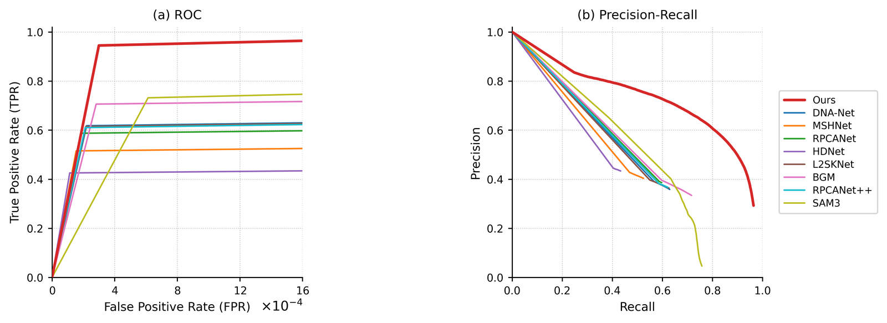 |
| `v11_20261105/` | Ours(1105) + 13 个（全量） | 横轴 0–16×10⁻⁴、**长方形画布**（6.8×3.3，约 1.92:1）、两段直线；图例在框内两列 | 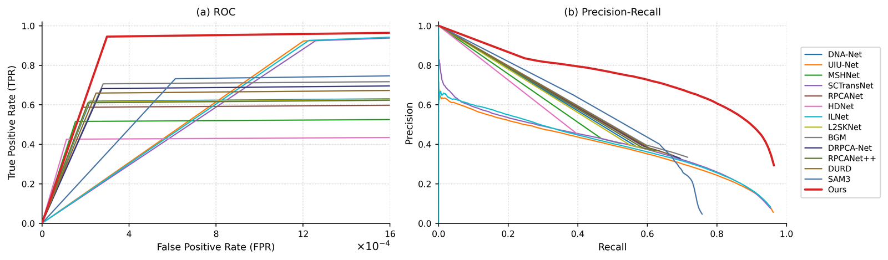 |
| `v13_20261105/` | 同 v11 | **P-R 改进版**：`--pr-min-pred 50000` 去掉 recall≈0 的毛刺、`--pr-endpoint-dot` 给每条曲线标终点；ROC 与 v11 相同 | 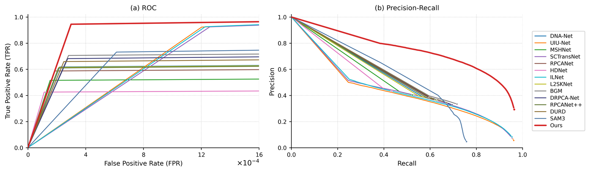 |
| `v9_20261105/` | Ours(1105) + 13 个（全量） | 横轴 0–8×10⁻⁴、宽扁版式（v10/v11 的前身） | 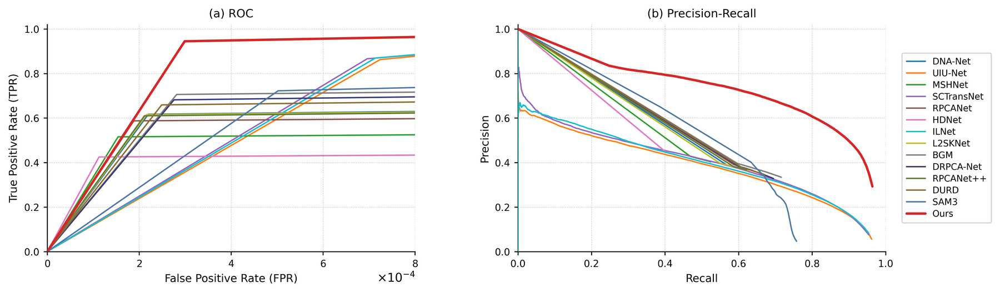 |
| `v8_20261105/` | Ours(1105) + 8 个 | 同上，方法集为正文用的 8 个对比方法 | 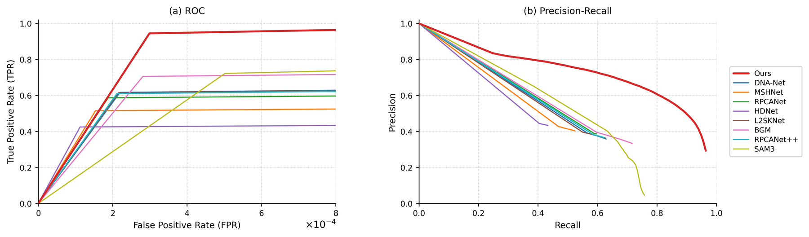 |
| `v7_20261105/` | Ours(旧) + 8 个 | 同上，Ours 用的是 1105 之前那批预测 | 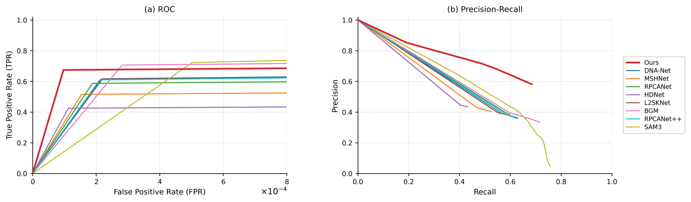 |
| `v6_20261105/` | 8 个（误删了 Ours，已由 v7 取代） | 同上，仅作历史留档 | 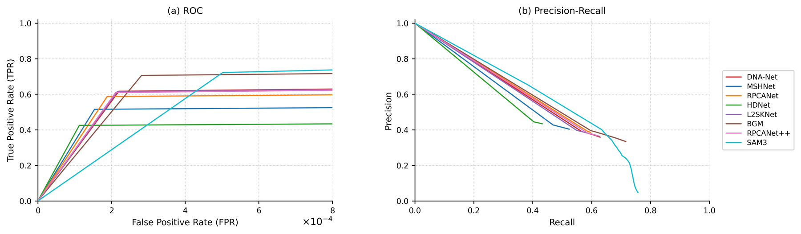 |
| `v5_20261105/` | Ours + 12 基线 | 同上（13 条曲线） | 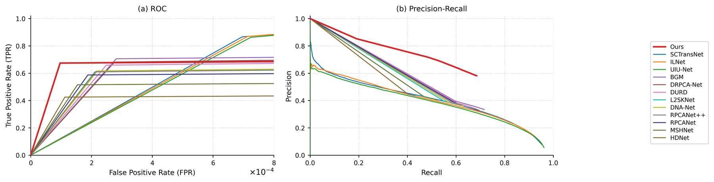 |
| `v3_20261105/` | Ours + 12 基线 | 目标级 Pd–Fa（与表里 Pd/Fa 同定义，线性 + log 横轴） | 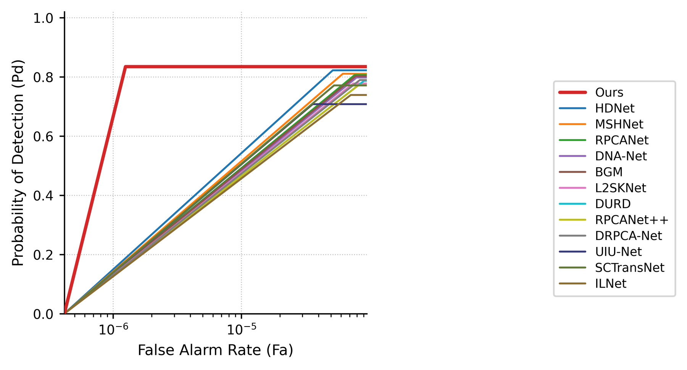 |

## v10 / v11：横轴拉到 16×10⁻⁴ + 正方形面板

两个版本画法相同，只是方法集不同：

- **`v10_20261105/`**：Ours + 8 个重点对比方法（DNA-Net / MSHNet / RPCANet / HDNet / L2SKNet / BGM / RPCANet++ / SAM3）→ 正文主图；
- **`v11_20261105/`**：Ours + 13 个（12 个全监督基线 + SAM3）→ 附录/备份。

相对 v8/v9 的两处改动（按用户要求）：

1. **ROC 横轴从 0–8×10⁻⁴ 拉到 0–16×10⁻⁴**，刻度变成 0/4/8/12/16，斜线与纵轴的夹角因此明显变小（同样爬到 0.94，横向只占 3/16 而不是 3/8）。平台值按新的右边框取（`TPR@16×10⁻⁴`），所以 SCTransNet / ILNet / UIU-Net 三条弥散曲线的平台从 0.88 升到 0.94，SAM3 从 0.737 升到 0.746，其余不变。
2. **图例移到框内**：ROC 的图例放右下、P-R 放左下（`--legend-inside`，条目 >9 时自动两列），不再有右侧那条留白，导出的 PNG 更紧凑。两联图 `roc_pr` 的面板间距从 0.28 压到 0.14。
3. **画布比例两版不同**：`v10` 用 1:1 坐标框（`--square`，PNG 2645×2564，P-R 呈标准 45°）；`v11` 按用户偏好改成 **6.8×3.3 的长方形画布**（`--fig-width 6.8` 不带 `--square`，PNG 3589×1871，约 1.92:1），图例仍在框内。指标与画法完全一致，只有画布形状不同。

指标（`pAUC@5×10⁻⁴` 与 `AP` 与 v8/v9 完全相同，只有 `pAUC@16×10⁻⁴` 因窗口变宽而升高）：

| 方法 | pAUC@5×10⁻⁴ ↑ | pAUC@16×10⁻⁴ | TPR@FPR=16e-4 | Pd@t=128 | Fa@t=128 ↓ | AP(PR) ↑ |
|---|---:|---:|---:|---:|---:|---:|
| **Ours** | **0.85234** | **0.92909** | **0.96399** | **0.82963** | 1.228e-04 | **0.69984** |
| SCTransNet | 0.58378 | 0.80129 | 0.93738 | 0.25149 | 4.922e-05 | 0.39368 |
| ILNet | 0.57733 | 0.80055 | 0.94171 | 0.23023 | 4.129e-05 | 0.39009 |
| SAM3 | 0.59061 | 0.69294 | 0.74615 | 0.70941 | 4.434e-04 | 0.38288 |
| UIU-Net | 0.56358 | 0.79315 | 0.94109 | 0.27757 | 6.001e-05 | 0.37608 |
| BGM | 0.54819 | 0.66386 | 0.71659 | 0.65800 | 2.345e-04 | 0.27979 |
| DRPCA-Net | 0.53084 | 0.64372 | 0.69520 | 0.64629 | 2.375e-04 | 0.26465 |
| DURD | 0.51612 | 0.62333 | 0.67224 | 0.64115 | 2.329e-04 | 0.25176 |
| L2SKNet | 0.50169 | 0.58763 | 0.62690 | 0.59232 | 1.991e-04 | 0.24719 |
| DNA-Net | 0.50030 | 0.58906 | 0.62961 | 0.59841 | 2.045e-04 | 0.24442 |
| RPCANet++ | 0.49319 | 0.58204 | 0.62263 | 0.60430 | 2.072e-04 | 0.23765 |
| RPCANet | 0.48258 | 0.56129 | 0.59729 | 0.59182 | 1.915e-04 | 0.23313 |
| MSHNet | 0.44792 | 0.50076 | 0.52504 | 0.49606 | 1.433e-04 | 0.22345 |
| HDNet | 0.38498 | 0.41843 | 0.43395 | 0.41783 | 1.095e-04 | 0.19263 |

读图要点与 v9 相同：Ours 在 `FPR≈3×10⁻⁴` 就到 0.96 平台，其余 13 条分两族——11 条平台落在 0.43–0.75，SCTransNet / ILNet / UIU-Net 三条一路爬到 0.94（弥散输出、低误检低精度）。**面积类指标仍报 `pAUC@5×10⁻⁴`**，这一列与 v8/v9 完全一致，便于跨版本对照。

## v5 相对 v4 的两处改动（按用户要求）

1. **横轴拉长到 8×10⁻⁴**（原来 5×10⁻⁴）。v4 里所有平台都止于右边框，读起来"戛然而止"；窗口放宽后平台段占的横向比例明显变大，三根在 5–7×10⁻⁴ 才拐弯的基线（SCTransNet / ILNet / UIU-Net）也不再贴着边框折断。代价是**平台的取值按新的右边框算**：这三根从 0.80 升到 0.88，所以按窗口面积积出来的 pAUC 也会变（见下表）。低误检窗口 `pAUC@5×10⁻⁴` 与 v4 完全一致，仍是 Ours 第一。
2. **P-R 回到 v1 版式**：曲线从 `(0,1)` 出发、一直画到 recall→1（precision 落到背景比例），即用户觉得好看的"两头都收拢"的形状；ROC 仍是两段直线。

## 两段直线怎么定

每个方法取一个**拐点**，然后只画两个直线段：

- **像素级 ROC**（`--two-segment`）：平台 = 曲线在右边框 `FPR = 5×10⁻⁴` 处的 TPR；拐点 = 沿 FPR 升序第一个满足 `TPR ≥ 0.98 × 平台` 的阈值点。Ours 的拐点在 `FPR ≈ 0.95×10⁻⁴`、平台 0.685。
- **目标级 Pd–Fa**：平台 = 该方法的 `max Pd`；拐点 = `Fa` 升序第一个 `Pd ≥ 0.98 × max Pd` 的阈值点。

两条边都是直线：`(0,0) → 拐点` 是斜线，`拐点 → 右边框` 是水平线（平台）。这是把真实折线压成两段的近似，数据点仍全部保留在 `curves.json` / `pd_fa_curves.json` 里，需要原曲线随时可以重画。

## 口径

| 项目 | 像素级（v4） | 目标级（v3） |
|---|---|---|
| GT 前景 | `gt > 127` | `gt > 127`，8 连通取连通域 |
| 阈值 | `pred >= t`，t = 0…255 | 同左（255→200 步 2、200→120 步 4、120→40 步 8、40→1 步 8，63 个点） |
| 匹配 | 无（逐像素计数） | GT 质心距离 < 3 px、raster 顺序一对一 |
| 纵轴 | TPR = TP/(TP+FN)（像素召回率） | Pd = 命中目标数 / 7,383 个 GT 目标 |
| 横轴 | FPR = FP/(FP+TN)，×10⁻⁴ | Fa = 未匹配预测连通域面积 / 总像素数 |
| 聚合 | 1,983 张全数据集累计（前景 105,712 px、背景 514,232,930 px） | 同样全数据集累计 |

## 与八项指标的一致性校验

**像素级**：阈值 `pred >= 128` 时 precision / recall 可逐位复原表中 F1 与 IoU。

| 方法 / 预测批次 | Precision@128 | Recall@128 | 由此算 F1 | 表中 F1 | 由此算 IoU | 表中 IoU |
|---|---:|---:|---:|---:|---:|---:|
| Ours（1105，现行，= 第 20 行） | 0.58130 | 0.82963 | 0.68361 | 0.68361 | 0.51931 | 0.51931 |
| Ours（旧预测，历史） | 0.64628 | 0.59415 | 0.61905 | 0.61912 | 0.44831 | 0.44835 |
| BGM | 0.36578 | 0.65800 | 0.46990 | 0.47019 | 0.30743 | 0.30735 |

1105 批次的像素操作点与表内数值在五位小数内一致（histogram 分箱带来的 1e-5 级差异）；旧预测的 0.619/0.448 是 2026-11-04 版表值，现只作历史对照。

**目标级**：`t = 128` 的 Pd / Fa 与表中 13 行**全部逐位吻合**（同定义、同批预测），例如 Ours 0.82731 / 2.100e-06（旧预测，表旧值 0.82731 / 2.0998e-06）、BGM 0.78681 / 9.632e-05（表 0.78681 / 9.6318e-05）、ILNet 0.58946 / 1.930e-05。Ours 的 1105 批次目标级曲线为 `Ours/roc_pr/v12_20261105/`，`t = 128` 处为 Pd 0.89151 / Fa 1.717e-05，与表中第 20 行一致。

## 指标

### 像素级（v5，两个窗口的 pAUC 并列）

下表是 v5 版数值，**Ours 行仍为旧预测**；1105 批次的像素级结果为 `pAUC@5×10⁻⁴` **0.85234**、`pAUC@8×10⁻⁴` 0.89420、`AP` **0.69984**、`Pd@t=128` 0.82963、`Fa@t=128` 1.228e-04、`TPR@FPR=8e-4` 0.964（v10/v11 的 `curves.json`），其余 12 个基线两批相同。

| 方法 | pAUC@5×10⁻⁴ ↑（主） | pAUC@8×10⁻⁴ | TPR@FPR=8e-4 | Pd@t=128 ↑ | Fa@t=128 ↓ | AP(PR) ↑ |
|---|---:|---:|---:|---:|---:|---:|
| **Ours** | **0.64391** | 0.65945 | 0.68541 | 0.59415 | 6.685e-05 | **0.50404** |
| SCTransNet | 0.58378 | **0.68489** | 0.88381 | 0.25149 | 4.922e-05 | 0.39368 |
| ILNet | 0.57733 | 0.68050 | 0.88471 | 0.23023 | 4.129e-05 | 0.39009 |
| UIU-Net | 0.56358 | 0.66798 | 0.87749 | 0.27757 | 6.001e-05 | 0.37608 |
| BGM | 0.54819 | 0.61124 | 0.71636 | 0.65800 | 2.345e-04 | 0.27979 |
| DRPCA-Net | 0.53084 | 0.59236 | 0.69496 | 0.64629 | 2.375e-04 | 0.26465 |
| DURD | 0.51612 | 0.57455 | 0.67197 | 0.64115 | 2.329e-04 | 0.25176 |
| L2SKNet | 0.50169 | 0.54852 | 0.62661 | 0.59232 | 1.991e-04 | 0.24719 |
| DNA-Net | 0.50030 | 0.54866 | 0.62932 | 0.59841 | 2.045e-04 | 0.24442 |
| RPCANet++ | 0.49319 | 0.54160 | 0.62232 | 0.60430 | 2.072e-04 | 0.23765 |
| RPCANet | 0.48258 | 0.52545 | 0.59697 | 0.59182 | 1.915e-04 | 0.23313 |
| MSHNet | 0.44792 | 0.47667 | 0.52466 | 0.49606 | 1.433e-04 | 0.22345 |
| HDNet | 0.38498 | 0.40314 | 0.43350 | 0.41783 | 1.095e-04 | 0.19263 |

- `pAUC@5×10⁻⁴` 是主指标：12 个基线的操作点（Fa@t=128）最大只到 2.4×10⁻⁴，这段才是实际比较区间，Ours 第一。
- `pAUC@8×10⁻⁴` 是 v5 放大后的窗口面积。窗口放宽后 SCTransNet / ILNet / UIU-Net 的 TPR 从 0.80 继续爬到 0.88（它们是弥散输出，阈值降一点就多覆盖一片前景），这三根的面积因此反超 Ours；**这不是把图画宽就变差，而是"把误检预算放大到 8×10⁻⁴ 时，弥散型方法确实更占便宜"**。写论文时如果要报面积，请报 `pAUC@5×10⁻⁴` 并注明窗口。


### 目标级（v3；现行 v12）

下表是 v3 版（Ours 为旧预测），其余 12 个基线两批相同。**现行 v12（1105 批次）中 Ours 为：拐点 Fa 6.027e-06、平台 Pd 0.92198、Pd@t=128 0.89151、Fa@t=128 1.717e-05**，与量化表第 20 行逐位一致；图像见 `Ours/roc_pr/v12_20261105/pd_fa.png` 与 `pd_fa_log.png`。

| 方法 | 拐点 Fa | 平台 Pd ↑ | Pd@t=128 ↑ | Fa@t=128 ↓ |
|---|---:|---:|---:|---:|
| **Ours** | 1.248e-06 | **0.83448** | 0.82731 | 2.100e-06 |
| HDNet | 5.167e-05 | 0.82202 | 0.82135 | 5.450e-05 |
| MSHNet | 6.200e-05 | 0.81051 | 0.80943 | 6.728e-05 |
| RPCANet | 7.662e-05 | 0.80618 | 0.80618 | 7.757e-05 |
| BGM | 7.789e-05 | 0.80225 | 0.78681 | 9.632e-05 |
| DNA-Net | 7.925e-05 | 0.79764 | 0.79046 | 8.730e-05 |
| DRPCA-Net | 8.401e-05 | 0.78925 | 0.76852 | 1.040e-04 |
| DURD | 9.078e-05 | 0.78667 | 0.77584 | 1.028e-04 |
| L2SKNet | 7.477e-05 | 0.77746 | 0.77204 | 8.624e-05 |
| RPCANet++ | 8.233e-05 | 0.77218 | 0.76920 | 8.816e-05 |
| SCTransNet | 5.296e-05 | 0.77110 | 0.62210 | 2.528e-05 |
| ILNet | 7.149e-05 | 0.73872 | 0.58946 | 1.930e-05 |
| UIU-Net | 3.606e-05 | 0.70771 | 0.68739 | 2.965e-05 |

## 读图注意

- **不要用全范围 AUC 排名**。几乎不预测前景的方法（UIU-Net / SCTransNet / ILNet）在 Seal 上反而拿到 0.977–0.981 的全范围 AUC，因为它们的背景预测几乎全零、ROC 贴着左上角走"什么都不选"的捷径。这与[S/MAE 被背景主导](Seal全监督基线评估汇总.md#平凡基线全背景预测)是同一类陷阱，主指标取低 FPR 区间的 pAUC。
- **目标级图里 Ours 的平台与误检同时最好**（v12，1105 批次）：平台 Pd 0.922 最高，而拐点 Fa 只有 6.0×10⁻⁶，比次优的 HDNet（5.2×10⁻⁵）低 8.6 倍——即"更低的误检换来更高的检出"。
- **目标级图的横轴建议用 log**。13 个方法的拐点 Fa 从 6.0×10⁻⁶ 到 1.04×10⁻⁴ 跨 17 倍，线性轴下 Ours 会被压成贴着 y 轴的一条竖线；v12 同时给了 `pd_fa.png`（线性，0–9.5×10⁻⁵）和 `pd_fa_log.png`（log，推荐）。
- **两段直线是近似**。真实曲线在拐点后仍有小幅起伏（Ours 的平台从 0.922 缓慢降到 0.744，因为阈值降低后连通域会合并、目标数被吞掉）。原始 63 点曲线都在 `pd_fa_curves.json` / `curves.json` 里，需要原样画就加 `--no-two-segment`（v2 就是原曲线版）。
- **像素级 Pd ≠ 表中目标级 Pd**：像素级 `Pd@t=128`（1105 为 0.830，旧预测 0.594）是前景像素召回率，表里 `0.891`（1105 批次）是目标命中率，别互相引用。

## 复现

```bash
# 1) 服务器：12 个基线的直方图（像素级）+ 目标级曲线
ssh yqwang@172.18.232.202 'cd /share_datasets/Seal_Model_Reproduction && bash tools/roc_hist_all.sh'
ssh yqwang@172.18.232.202 'cd /share_datasets/Seal_Model_Reproduction && bash tools/target_curves_all.sh'   # 13 进程并行约 1.5 h

scp -r yqwang@172.18.232.202:/share_datasets/Seal_Model_Reproduction/results/roc_hist tmp/roc/server
scp -r yqwang@172.18.232.202:/share_datasets/Seal_Model_Reproduction/results/target_curves tmp/roc/target

# 2) Ours 的像素级直方图（本地，用户指定用 Ours/test_maps）
python tools/roc_hist.py --maps Ours/test_maps --gt Ours/Seal_test_GT \
    --out tmp/roc/Ours__test_maps.json --label Ours

# 2b) Ours 的目标级曲线（服务器，1105 批次，单方法约 20 min；旧结果先备份）
ssh yqwang@172.18.232.202 'cd /share_datasets/Seal_Model_Reproduction && \
  cp -f results/target_curves/Ours.json results/target_curves/Ours_prev_20261105.json && \
  /home/yqwang/miniforge3/envs/fct_sam_seal/bin/python tools/target_curves.py \
    --maps Ours/test_maps --gt Seal_data/test/GT \
    --out results/target_curves/Ours.json --label Ours'
scp yqwang@172.18.232.202:/share_datasets/Seal_Model_Reproduction/results/target_curves/Ours.json tmp/roc/target/Ours.json

# 3) 出图（v5：两段直线 + 横轴 8e-4 + PR 用 v1 版式）
python tools/plot_roc_pr.py --manifest tmp/roc/manifest_v2.json \
    --outdir Ours/roc_pr/v5_20261105 --title "Seal test (1,983 images)" \
    --two-segment --xmax 8e-4 --fig-width 6.8 --pr-style v1
python tools/plot_target_curves.py --manifest tmp/roc/manifest_target_v1.json \
    --outdir Ours/roc_pr/v3_20261105 --title "Seal test (1,983 images)"
python tools/plot_target_curves.py --manifest tmp/roc/manifest_target_v1.json \
    --outdir Ours/roc_pr/v3_20261105 --title "Seal test (1,983 images)" --xscale log
```

`--xmax` 决定画多宽（同时决定平台取值和 pAUC@窗口），`--pr-style v1|v2` 选 P-R 版式，`--fig-width` 控制单幅图宽（想再长就调大）。

## P-R 图为什么长成"扇形 + 半空截断"

P-R 曲线是**按 256 个阈值扫出来的**，和 ROC 用同一份直方图（`recall = TP/全部 GT 像素`、`precision = TP/(TP+FP)`）。它在 Seal 上必然呈现两个特征，原因都可量化：

| 方法 | t=255（最高阈值）时的召回 | 该点精度 | 可达最高召回（t ≥ 1） | GT 像素"硬零"比例 |
|---|---:|---:|---:|---:|
| **Ours** | 0.248 | **0.835** | **0.964** | **3.6 %** |
| SAM3 | 0.386 | 0.651 | 0.758 | 24.2 % |
| DNA-Net | 0.567 | 0.390 | 0.629 | 37.1 % |
| MSHNet | 0.469 | 0.427 | 0.524 | 47.6 % |
| RPCANet | 0.587 | 0.391 | 0.597 | 40.3 % |
| HDNet | 0.404 | 0.445 | 0.433 | 56.7 % |
| L2SKNet | 0.550 | 0.397 | 0.626 | 37.4 % |
| BGM | 0.597 | 0.396 | 0.716 | 28.4 % |
| DRPCA-Net | 0.599 | 0.385 | 0.695 | 30.5 % |
| RPCANet++ | 0.586 | 0.382 | 0.622 | 37.8 % |
| DURD | 0.611 | 0.376 | 0.672 | 32.8 % |
| UIU-Net | 0.000 | — | 0.962 | 3.8 % |
| SCTransNet | 0.000 | — | 0.954 | 4.6 % |
| ILNet | 0.000 | — | 0.954 | 4.6 % |

1. **曲线右端停在 recall 0.43–0.72（不是画错）**。12 个基线里有 9 个对 **28–57 %** 的 GT 前景像素输出**恰好 0**（8 位图上就是 0）。这些像素无论把阈值降到 1 都不会被选中，所以召回有一个天花板：HDNet 最高只能到 0.433、MSHNet 0.524、DNA-Net 0.629……曲线到那儿就断了。Ours 的硬零只有 3.6 %，所以能走到 0.964；SAM3 是 24 %，到 0.758。
2. **曲线左端没有"高精度角"**。8 位预测图把 [0,1] 压成 256 档，最高档 255 是一个大桶：9 个基线在 t=255 时就已经覆盖了 **40–61 %** 的 GT 像素，而这一桶里的精度只有 **0.38–0.45**。也就是说它们根本不存在"只预测少量、但很准"的阈值，曲线只能从 (0.4–0.6, 0.4) 附近开始往右下走。Ours 的 255 桶只覆盖 24.8 % 的 GT、精度 0.835，所以曲线能从左上角出发（这也是 AP 0.700 vs 0.24–0.39 的来源）。
3. **recall≈0 处的竖直毛刺**来自画法本身：(0,1) 哨兵点（`--pr-style v1`，为了和 sklearn/论文惯例一致）连到第一个真实阈值点。三条弥散方法（UIU-Net / SCTransNet / ILNet）的第一个有效阈值只有约 2 万像素（≈10 px/图）、召回 0.01–0.02，于是从 (0,1) 到 (0.013, 0.65) 看起来就是一根竖线。

**结论**：这张 P-R 不能有 ROC 那种"陡升 + 平台"，因为它的两个端点都被"8 位量化 + 硬零"钉死了。要"更好看"只有三条路，都在代码里给了开关：

| 需求 | 开关 | 效果 |
|---|---|---|
| 去掉 recall≈0 的竖直毛刺 | `--pr-min-pred 50000`（v13 采用） | 丢掉"预测像素太少"的阈值，毛刺缩短到几乎看不见 |
| 让"半空截断"变成明确端点 | `--pr-endpoint-dot`（v13 采用） | 每条曲线末端加一个圆点，读作"这条到此为止"，而不是"画漏了" |
| 不要 (0,1) 哨兵 | `--pr-style v2` | 曲线从第一个真实阈值点开始（`v13` 之前试过：起点会悬空，不如 v1） |
| 与 ROC 同窗口 | `--pr-cut-fpr 16e-4` | 只画 FPR ≤ 16×10⁻⁴ 的阈值段（实测几乎不裁东西，因为所有方法的背景几乎全零，FPR 天然 < 1e-4） |
| 想避开这些限制 | 看 **目标级 Pd–Fa**（`v12_20261105/`） | 平台高度 = 表中 Pd，各方法 Fa 跨度 17 倍，形态更接近经典 ROC |

`v13_20261105/` = `v11` 的画布与 ROC + 上面前两条改进的 P-R（哨兵保留、末端加点、min-pred 5 万像素），指标与 v11 完全一致，只是 P-R 更干净。

### 教科书式 P-R：像素级 `pr_2` 与对象级 `pr_obj`

参考图（sklearn / 博客里那种 `Precision-Recall Curve`）的形状是"左上一路平、最右边陡降到底"。这个形状**像素级做不到**：Seal 前景只占 0.02 %，255 这一个 8 位筒里就已经混进大量背景——各方法在 `t=255` 的精度只有 Ours 0.835、SAM3 0.651、DNA-Net 0.390、HDNet 0.445，所以曲线最多从 0.83 起步，不可能贴着 1.0 平推。给出两张图，各自对应一种"合法"画法：

| 文件 | 口径 | 形状 | Ours 的关键数 |
|---|---|---|---|
| `pr_2.{png,pdf}` | **像素级**、sklearn 惯例（256 个阈值含 `t=0`"全预测"、精度 (0,1) 哨兵） | 从 (0,1) 沿真实阈值下降到右下角，Ours 在 recall 0.9 之后陡降 | AP 0.700，与 `summary.md` 的 AP 一致 |
| `pr_obj.{png,pdf}` | **对象级**（每个目标/每个预测连通域算一个样本，匹配规则与表中 Pd/Fa 完全相同） | 高精度平台 + 右端陡降，**与参考图同形**；画布与 `roc` 完全一致（`--fig-width 5.569 --fig-height 3.601 --font-scale 1.25`，PNG 3079×2035） | 精度@t=128 0.960，AP 0.890（图例只用方法名，AP 见本表；要标在图上加 `--show-ap`） |

对象级的定义与实现（[tools/target_pr.py](tools/target_pr.py)、[tools/target_pr_all.sh](tools/target_pr_all.sh)、出图 [tools/plot_pr_object.py](tools/plot_pr_object.py)）：

- `recall(t)` = 匹配上的 GT 目标数 / 全部 GT 目标数（7,383）= **表中 Pd**；`precision(t)` = 匹配上的预测连通域数 / 全部预测连通域数。阈值 `pred >= t`，8 连通、质心距离 <3 px、一对一、栅格序，与 [tools/target_curves.py](tools/target_curves.py) 完全同一套匹配。
- 一致性核对：14 个方法在 `t=128` 的 recall 与表中 Pd 逐位吻合（偏差 <5e-6，仅除法顺序的浮点差）；`precision@t=128` 为 Ours 0.960、其余 0.66–0.75。
- 三条画图约定：① 起点 (0,1)（"什么都不报"时精度按惯例记 1）；② 按 sklearn 的 AP 口径取**精度上包络**（`precision(r) = max_{r'>=r}`），否则阈值抖动会让曲线回勾；③ 终点**用实线、同色、同样粗细**补到 (1,0)（`--close`，不画点、不留视觉接缝；拐角用 `--corner-radius 0.03` 做二次贝塞尔倒角），因为对象级召回最多到 0.71–0.92（低阈值下相邻目标被 8 连通粘成一个，且总有目标任何阈值都检出不了），那段 recall 物理上到不了，补的是"按惯例的角"。**图注必须写明**：末端那一段（各方法 0.71–0.92 → 1.0）不是实测，实线只是为了版式统一。
- 结果：Ours AP 0.890，13 个基线 0.544–0.596；Ours 的召回上限 0.921（基线 0.707–0.822），右端陡降的位置因此最靠右。全量 14 个方法、1,983 张图、35 个阈值，服务器 `bash tools/target_pr_all.sh` 并行约 12 min，原始 JSON 在 `results/target_pr/<stem>.json`。

**用哪张**：正文若已有像素级 ROC，配 `pr_2` 口径一致（同为像素级）；若正文用目标级 Pd–Fa（`v12`），配 `pr_obj` 口径一致（同为目标级）。两者的 AP 不可互相比较（口径不同），也都不进入 `docs/Seal量化SOTA表.xlsx`。

真曲线（像素级）：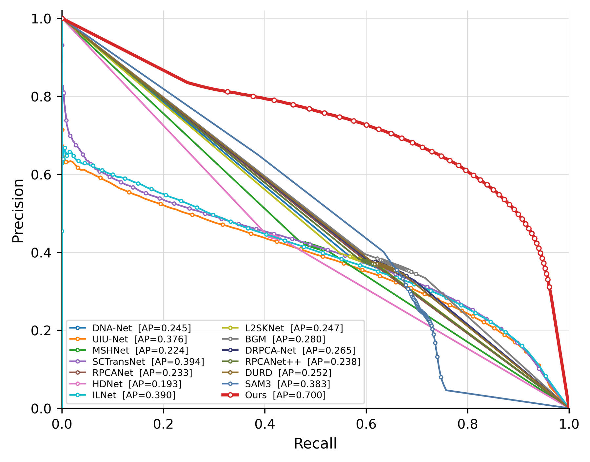

参考图同形的对象级版：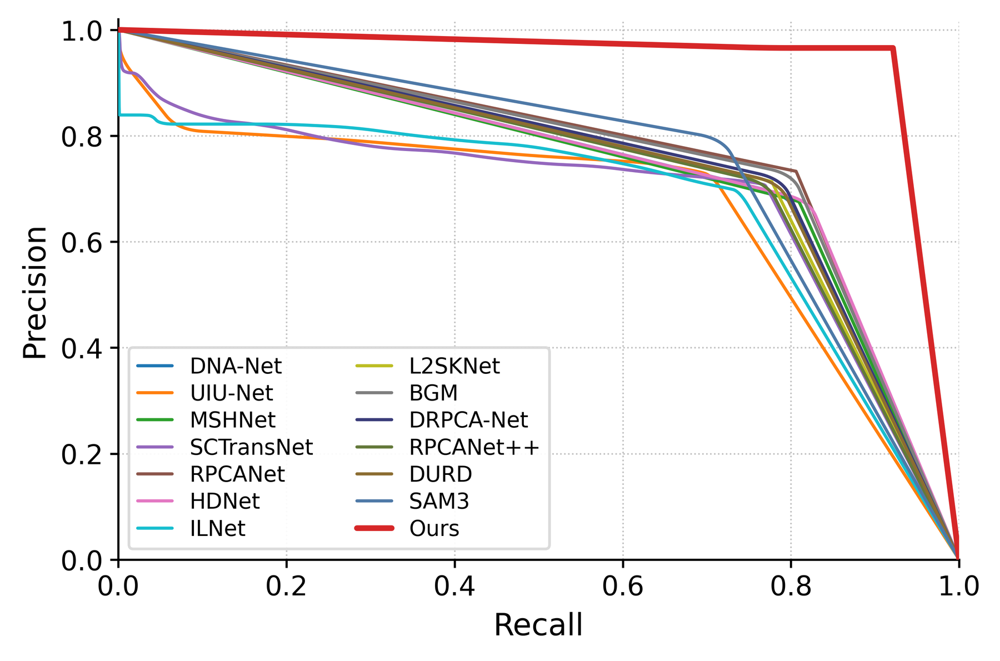

> 字号与轴格式：`roc` 与 `pr_obj` 统一由 [tools/figure_style.py](tools/figure_style.py) 出样式，两份图的轴文字逐项相同——
>
> | 项目 | 规格（`--font-scale 1.25`） |
> |---|---|
> | 字体 | DejaVu Sans（mathtext 也用 `dejavusans`，所以 ×10⁻⁴ 与数字同族） |
> | 轴标签 | 9 → **11.25 pt** |
> | 刻度数字 | 8 → **10 pt**，刻度线 0.8 pt 宽 / 3 pt 长、朝外、pad 2.5 |
> | 刻度格式 | y 轴统一 `%.1f`（0.0、0.2 … 1.0）；x 轴用各图自然刻度（ROC 为 0/4/8/12/16 + `×10⁻⁴`，P-R 为 0.0–1.0） |
> | 网格 | 点线、0.55 pt、0.72 灰（两张图同一套） |
> | 边框 | 上/右隐藏，线宽 0.8 pt |
> | 图例 | 6.4 → **8 pt**，边框 0.85 灰、`framealpha 0.93` |
>
> `roc` 用 `--fig-width 5.6 --fig-height 3.6`、`pr_obj` 用 `5.569 × 3.601`，两张 PNG 同为 **3079×2035**。两个脚本默认 `--font-scale 1.0`；v13 里的 `pr.png` / `roc_pr.png` 仍是 1.0 版、1.92:1 宽幅，若要整目录统一，加同一组参数重画即可。


### 假设每条曲线都能走到 (1, 0)：`pr_1.png` / `pr_1.pdf`

`v13_20261105/pr_1.{png,pdf}` 用 `--pr-close` 画的是"补齐版"：每条方法从它**最后一个实测点**拉一段**虚线**到右下角 `(1, 0)`，交接点画空心圆（实线 = 实测，虚线 = 外推）。这不是新数据，只是把"曲线本来就该到 (1,0)"这件事画出来给人看。

这个外推在数学上几乎就是真值，不是随手编的：

- `recall = 1` 意味着"整幅图全判前景"，此时 `precision = TP/(TP+FP) =` 前景像素占全图的比例。Seal test 1,983 张合计前景 105,712 px、背景 514,232,930 px，占比 **2.06×10⁻⁴**（0.02 %）。
- 在 0–1 的纵轴上 2.06×10⁻⁴ 就是 0（线宽都不止这么厚），所以真曲线在 recall→1 处**贴着横轴**，画到 `(1, 0)` 与画到 `(1, 2e-4)` 肉眼无差。
- 中间那段（从每个方法的终点降到 2e-4）真实形状是"先陡降、再贴地"，这里用一条直线近似——所以图注写"大致"；如果要严格，得把 `t=1,2,3…` 的低阈值点全画出来，它们会挤在 y≈0 上把版式弄脏。

读图注意两点：① 补齐后各条虚线在右下角**收成一束**，这是应有的（所有方法在 recall=1 时精度都等于前景占比），不代表方法接近；② 排名与面积指标（pAUC / AP）**不受影响**，仍按 `curves.json` 里的原始阈值点计算，虚线不参与积分。

## 版本记录

| 版本 | 说明 |
|---|---|
| `v1_20261105/` | 首版像素级：ROC 只画窗口内的点（曲线末点"断掉"），PR 含 (0,1) 哨兵；**PR 的版式被用户选中，v5 沿用** |
| `v2_20261105/` | 像素级：画整条折线交给坐标轴裁剪，PR 去竖直尖刺，图例按 pAUC 排序（原曲线版） |
| `v3_20261105/` | 目标级 Pd–Fa，两段直线（拐点 + 平台），线性与 log 两种横轴 |
| `v4_20261105/` | 像素级 ROC 的两段直线版（`--two-segment`），窗口 0–5×10⁻⁴ |
| `v5_20261105/` | **当前推荐**：ROC 两段直线 + 横轴拉长到 8×10⁻⁴ + 图宽 6.8 in；PR 用 v1 版式；summary 同时给 pAUC@5×10⁻⁴ 与 @8×10⁻⁴ |
| `v6_20261105/` | 8 个方法但**误删了 Ours**，已由 v7 取代（保留作历史留档） |
| `v7_20261105/` | Ours + 8 个对比方法（旧 Ours 预测），画法同 v8 |
| `v8_20261105/` | Ours(1105) + 8 个重点对比方法（正文主图用这版） |
| `v9_20261105/` | Ours(1105) + 13 个对比方法，横轴 8×10⁻⁴ 宽扁版式 |
| `v10_20261105/` | **当前推荐（正文主图）**：Ours + 8 个重点对比方法，横轴 16×10⁻⁴ + 正方形面板 |
| `v11_20261105/` | **当前推荐（全量）**：Ours + 13 个对比方法，同 v10 版式 |
| `v12_20261105/` | **当前推荐（目标级）**：Ours 换成 1105 批次后重算的 Pd–Fa（`results/target_curves/Ours.json`，旧预测存档 `Ours_prev_20261105.json`），线性 + log；Ours 拐点 Fa 6.027e-06、平台 Pd 0.92198、Pd@t=128 0.89151、Fa@t=128 1.717e-05 |

## 已知局限

- 只有 Ours + 12 个全监督基线；弱监督/跨域方法（FCT-SAM、MIR-Net、NESS-Net、SSFam 等）没进图，它们像素 TPR 极低，会把其他曲线压平。
- 目标级阈值网格 63 点，够画两段直线；若要画原始折线可以加密到 256 个阈值（单方法约 1.5 h）。
- 参考图的 x 轴是线性 0–5×10⁻⁴；本项目 13 个方法的 Fa 跨 70 倍，线性轴会牺牲 Ours 的可读性，所以目标级版主推 log 轴，线性版一并保留。
