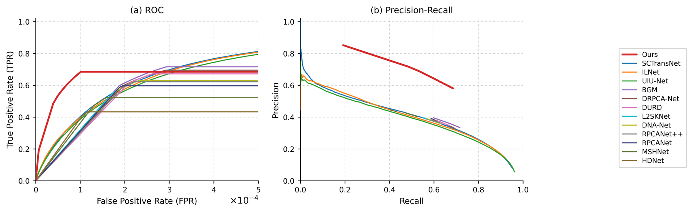

# Seal test 的 ROC / P-R 曲线（像素级）

Ours（`Ours/test_maps`，1,983 张）+ 12 个全监督 IRSTD 基线（服务器 `results/<Method>/Seal/fullsup_test_maps`）在 Seal test 上的像素级 ROC 与 Precision-Recall 曲线。版式对齐 IRSTD 论文常见的 "TPR vs FPR（×10⁻⁴）" 图（如 PDDiff Fig. 10 一类）：**每个方法一条折线**，图例按 pAUC 从高到低排在右侧。



当前版本 `Ours/roc_pr/v2_20261105/`；指标数值与 `v1_20261105/` 完全一致，v2 只改画法（见文末版本记录）。

## 口径

| 项目 | 说明 |
|---|---|
| 数据 | Seal test 1,983 张，与八项指标完全同一批预测 |
| GT 前景 | `gt > 127`（与 `evaluate_small_targets.py` 一致） |
| 预测阈值 | `pred >= t`，t = 0…255 的 8 位灰度值；8 位预测图最多给 256 个操作点，曲线是这些点的直接连线（未平滑） |
| TPR | = TP / (TP+FN) = 前景像素召回率（像素级，不是目标级 Pd） |
| FPR | = FP / (FP+TN) = 背景像素误检率；Seal 前景只占 0.0206 %，所以 FPR 天然落在 1e-4 量级 |
| 聚合 | 全数据集累计：1,983 张图的前景/背景预测值直方图相加后再算，不是按图平均 |
| 累计像素 | 前景 105,712 px，背景 514,232,930 px（每方法相同） |

## 流程

1. **服务器**：每个方法跑一次直方图统计，产出 ~3 KB 的 JSON（只有 256+256 个计数，不传 2 万张预测图）。

   ```bash
   cd /share_datasets/Seal_Model_Reproduction
   bash tools/roc_hist_all.sh        # 12 个基线 → results/roc_hist/<Method>.json
   ```

   Ours 在本地直接从 `Ours/test_maps` 统计（同一脚本，服务器 `Ours/test_maps` 与本地的 md5 一致）：

   ```bash
   python tools/roc_hist.py --maps Ours/test_maps --gt Ours/Seal_test_GT \
       --out tmp/roc/Ours__test_maps.json --label Ours
   ```

2. **本地**：manifest 里列出「标签 → 直方图 JSON」，一次出三张图（单幅 ROC、单幅 P-R、两联图），每张都存 PNG（600 dpi）+ PDF，另存 `curves.json`（逐阈值曲线）与 `summary.md`（指标表）。

   ```bash
   python tools/plot_roc_pr.py --manifest tmp/roc/manifest_v2.json \
       --outdir Ours/roc_pr/v2_20261105 \
       --title "Seal test (1,983 images)"
   ```

版本目录约定：`Ours/roc_pr/<version>/`，每次重画都新建版本目录，PNG 与 PDF 成对保存。

| 文件 | 内容 |
|---|---|
| `roc.png` / `roc.pdf` | 单幅 ROC，x 轴 FPR ×10⁻⁴，0–5 |
| `pr.png` / `pr.pdf` | 单幅 Precision-Recall |
| `roc_pr.png` / `roc_pr.pdf` | 并排两联图（(a) ROC + (b) P-R + 右侧统一图例） |
| `curves.json` | 13 个方法的逐阈值 FPR/TPR/precision，以及 pAUC/AP/Pd@128/Fa@128 |
| `summary.md` | 下面这张表的 Markdown 版 |

## 与八项指标的一致性校验

阈值取 `pred >= 128`（即二值图口径）时，本次直方图统计出的 precision / recall 应与八项指标逐位吻合：

| 方法 | Precision@128 | Recall@128 | 由此算 F1 | 表中 F1 | 由此算 IoU | 表中 IoU |
|---|---:|---:|---:|---:|---:|---:|
| Ours | 0.64628 | 0.59415 | 0.61905 | 0.61912 | 0.44831 | 0.44835 |
| BGM | 0.36578 | 0.65800 | 0.46990 | 0.47019 | 0.30743 | 0.30735 |
| DNA-Net | 0.37563 | 0.59841 | 0.46133 | 0.46154 | 0.29991 | 0.30000 |

（F1 = 2PR/(P+R)，IoU = PR/(P+R−PR)。第三位小数的差值来自 8 位量化与浮点求和顺序。）这说明曲线与主表出自同一批预测、同一阈值语义，没有换口径。

## 指标（主指标为 pAUC）

| 方法 | pAUC ↑ | TPR@FPR=5e-4 ↑ | Pd@t=128 ↑ | Fa@t=128 ↓ | Precision@t=128 | AUC（全范围） | AP(PR) ↑ |
|---|---:|---:|---:|---:|---:|---:|---:|
| **Ours** | **0.64386** | 0.68532 | 0.59415 | 6.685e-05 | 0.64628 | 0.84256 | **0.50410** |
| SCTransNet | 0.58376 | 0.81232 | 0.25149 | 4.922e-05 | 0.51226 | 0.97693 | 0.39369 |
| ILNet | 0.57732 | 0.80841 | 0.23023 | 4.129e-05 | 0.53408 | 0.97665 | 0.39010 |
| UIU-Net | 0.56356 | 0.79458 | 0.27757 | 6.001e-05 | 0.48740 | 0.98061 | 0.37608 |
| BGM | 0.54818 | 0.71628 | 0.65800 | 2.345e-04 | 0.36578 | 0.85798 | 0.27985 |
| DRPCA-Net | 0.53082 | 0.69487 | 0.64629 | 2.375e-04 | 0.35872 | 0.84727 | 0.26472 |
| DURD | 0.51611 | 0.67188 | 0.64115 | 2.329e-04 | 0.36142 | 0.83578 | 0.25183 |
| L2SKNet | 0.50167 | 0.62649 | 0.59232 | 1.991e-04 | 0.37953 | 0.81309 | 0.24727 |
| DNA-Net | 0.50027 | 0.62921 | 0.59841 | 2.045e-04 | 0.37563 | 0.81445 | 0.24450 |
| RPCANet++ | 0.49316 | 0.62221 | 0.60430 | 2.072e-04 | 0.37481 | 0.81095 | 0.23773 |
| RPCANet | 0.48254 | 0.59685 | 0.59182 | 1.915e-04 | 0.38848 | 0.79827 | 0.23322 |
| MSHNet | 0.44786 | 0.52452 | 0.49606 | 1.433e-04 | 0.41567 | 0.76210 | 0.22355 |
| HDNet | 0.38490 | 0.43333 | 0.41783 | 1.095e-04 | 0.43952 | 0.71650 | 0.19275 |

pAUC = FPR ∈ [0, 5×10⁻⁴] 的梯形面积除以 5×10⁻⁴，即图中可见区域的归一化面积。Ours 的 pAUC 与 AP 都是第一。

## 读图注意

- **不要用全范围 AUC 排名**。几乎不预测前景的方法在 Seal 上反而拿到 0.977–0.981 的全范围 AUC（UIU-Net / SCTransNet / ILNet），因为它们的背景预测几乎全零、ROC 曲线贴着左上角走一条"什么都不选"的捷径。这与[S/MAE 被背景主导](Seal全监督基线评估汇总.md#平凡基线全背景预测)是同一类陷阱，所以本图的主指标取低 FPR 区间的 pAUC。
- **Ours 在 FPR ≲ 2.5×10⁻⁴ 的区间整段在上**，而 12 个基线自己的操作点（Fa@t=128）最大只到 2.4×10⁻⁴（BGM），这段正好覆盖实际比较区间。P-R 图中 Ours 也整条在上（AP 0.504 vs 次优 0.394）。
- **曲线在 2.8×10⁻⁴ 附近交叉可以用"硬零"解释**：Ours 有 31.5 % 的 GT 前景像素预测值恰为 0，而 UIU-Net / SCTransNet / ILNet 只有 3.8–4.6 %（输出弥散、几乎处处有小值）。把阈值降到 1 也救不回 Ours 那些硬零像素，所以它的像素级 TPR 在 0.685 处饱和；弥散型方法则在极低 FPR 代价下继续爬升到 0.80。这反映的是输出稀疏度差异，不是"Ours 更差"。
- **像素级 Pd ≠ 表中目标级 Pd**。Ours 的 `Pd@t=128 = 0.59415` 是前景像素召回率，表里的 `Pd = 0.82731` 是"命中目标数/GT 目标数"（质心距离 <3 像素一对一匹配）。两者阈值相同、单位不同，不能互相引用。
- 13 条曲线共 256 个操作点，量化步长决定了横轴的稀疏程度；若审稿要求更平滑的曲线，需要让推理端输出 16 位概率图重算（当前预测图是 8 位）。

## 画法要点（v2 与 v1 的差别）

| 项目 | v1 | v2 |
|---|---|---|
| ROC 曲线 | 只画 FPR ≤ 5×10⁻⁴ 的**点**，曲线在末点处"断掉" | 画整条折线，由坐标轴裁剪 → 每条线自然冲出右侧边框，和示例图一样是"上升 + 平台" |
| PR 曲线 | recall=0 处补 (0,1) 哨兵点，画出一条竖直尖刺 | 哨兵点只用于 AP 积分，绘图从第一个真正检出目标的点开始 |
| 图例顺序 | 按 `xlsx` 表行序 | 按 pAUC 从高到低，Ours 在最上 |
| 配色/线宽 | tab20 前后重复色 | 13 个可区分色，Ours 用加粗红线（zorder 最高） |
| 指标 | pAUC / AP 数值 | 完全一致（v2 只改画法） |

## 复现

```bash
# 1) 服务器：12 个基线的直方图
ssh yqwang@172.18.232.202 'cd /share_datasets/Seal_Model_Reproduction && bash tools/roc_hist_all.sh'

# 2) 取回 JSON（约 40 KB）
scp -r yqwang@172.18.232.202:/share_datasets/Seal_Model_Reproduction/results/roc_hist tmp/roc/server

# 3) Ours 在本地统计（用户指定用 Ours/test_maps）
python tools/roc_hist.py --maps Ours/test_maps --gt Ours/Seal_test_GT \
    --out tmp/roc/Ours__test_maps.json --label Ours

# 4) 出图
python tools/plot_roc_pr.py --manifest tmp/roc/manifest_v2.json \
    --outdir Ours/roc_pr/v2_20261105 --title "Seal test (1,983 images)"
```

换 Ours 的预测（例如 Ours 全监督版、SAM3 版）只需换 manifest 里那一项的 `hist` 路径，或把 `Ours/SAM3-test_maps` 也加进去，然后新建 `v3_*` 目录重画。

## 版本记录

| 版本 | 说明 |
|---|---|
| `v1_20261105/` | 首版：13 条曲线，ROC 只画窗口内的点、PR 含 (0,1) 哨兵；指标同 v2 |
| `v2_20261105/` | 按示例图重画：每方法一条完整折线（右侧由坐标轴裁剪）、PR 去掉竖直尖刺、图例按 pAUC 排序、配色加粗 |

## 已知局限

- 只有 Ours + 12 个全监督基线；弱监督/跨域方法（FCT-SAM、MIR-Net、NESS-Net、SSFam 等）没有加进图里，它们的像素 TPR 极低，加进去会把其他曲线压平。
- 参考图（SIRST4 / SIRST-UAVB）是每个数据集一幅、16 个方法；本项目只有 Seal 一个数据集，所以做成单数据集 + (a) ROC / (b) P-R 两联。
- 目前是像素级曲线。目标级 Pd–Fa 曲线（阈值网格上逐图做 8 连通 + 质心匹配）已备好脚本 [tools/target_curves.py](../tools/target_curves.py) 与 [tools/target_curves_all.sh](../tools/target_curves_all.sh)，13 个方法并行约需 1.5 小时；它的平台高度就是表中 Pd（Ours 0.83 最高），形态更接近示例图，需要时可以出 `v3`。
